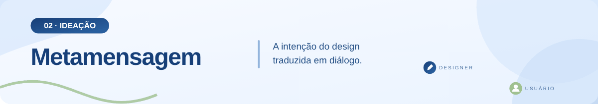

  <a href="../README.md"> Início</a> &nbsp;›&nbsp;
  <b>Etapa 2 · Ideação</b> &nbsp;›&nbsp;
  Metamensagem

---

# 2. Metamensagem

## 2.1. Introdução

A metamensagem é um conceito da Engenharia Semiótica que representa a comunicação estabelecida entre os designers de um sistema e seus usuários por meio da interface. Ela expressa a intenção da equipe ao desenvolver o produto, explicando quem são seus usuários, quais necessidades foram consideradas, quais problemas o sistema busca solucionar e como as funcionalidades disponíveis podem ajudá-los.

No desenvolvimento do Camp Food, a metamensagem orienta as decisões de design, garantindo que a interface transmita de maneira clara a proposta do aplicativo e permita que os usuários compreendam como utilizá-lo de acordo com seus objetivos.

## 2.2. Contexto do Camp Food

O Camp Food é uma proposta de aplicativo voltada à comunidade acadêmica da Universidade Federal do Amazonas (UFAM), com o objetivo de facilitar a comercialização e a localização de alimentos no ambiente universitário.

O projeto considera dois perfis principais de usuários:

- **Vendedores:** estudantes ou membros da comunidade acadêmica que comercializam alimentos de maneira autônoma no hall da universidade e precisam organizar seus produtos, controlar a disponibilidade e acompanhar os pedidos.
- **Compradores:** estudantes que possuem uma rotina acadêmica movimentada e desejam encontrar alimentos disponíveis, consultar informações e realizar suas compras com praticidade.

Entre os principais problemas identificados estão a dificuldade de encontrar vendedores e produtos disponíveis, a falta de informações centralizadas sobre preços e ingredientes e a necessidade de organizar as vendas e os pedidos.

Além disso, o projeto considera a acessibilidade como um aspecto importante da experiência, buscando atender usuários com diferentes necessidades por meio de recursos como ajuste do tamanho das fontes, contraste visual e compatibilidade com leitores de tela.

## 2.3. Metamensagem do Camp Food

"Caro(a) usuário(a) do Camp Food,

Entendemos que você faz parte da comunidade acadêmica da Universidade Federal do Amazonas (UFAM) e possui uma rotina universitária movimentada. Seja você um(a) vendedor(a) autônomo(a), que comercializa alimentos no hall da universidade, ou um(a) estudante que busca refeições e lanches de maneira rápida e prática, sabemos que encontrar ou oferecer produtos pode ser um desafio em meio às atividades do dia a dia. Por isso, buscamos proporcionar uma experiência mais organizada, acessível e independente.

Pensando nessas necessidades, desenvolvemos o Camp Food, uma plataforma digital que aproxima vendedores(as) e compradores(as) dentro do ambiente universitário. Por meio de uma interface intuitiva, os(as) vendedores(as) podem cadastrar e gerenciar seus produtos, atualizar a disponibilidade do estoque e acompanhar os pedidos recebidos, tornando a organização das vendas mais simples e eficiente.

Para os(as) compradores(as), o aplicativo oferece um ambiente centralizado para explorar os produtos disponíveis, visualizar fotografias, consultar descrições, ingredientes, preços e informações de disponibilidade. Assim, você pode conhecer as opções oferecidas pelos vendedores antes mesmo de se deslocar até eles, facilitando suas escolhas e economizando tempo.

Também reconhecemos que cada pessoa possui necessidades diferentes. Por isso, o Camp Food considera recursos de acessibilidade, como ajuste do tamanho das fontes, contraste visual e compatibilidade com leitores de tela, buscando proporcionar uma experiência mais inclusiva e reduzir barreiras durante a utilização da plataforma.

Com o Camp Food, queremos tornar a experiência de comprar e vender alimentos na universidade mais prática, organizada e acessível. Nosso objetivo é aproximar a comunidade acadêmica, facilitar as atividades dos vendedores e permitir que os estudantes encontrem o que procuram com mais autonomia, no seu próprio ritmo."

## 2.4. Relação da Metamensagem com as Personas e os Objetivos

A metamensagem foi construída considerando as necessidades e os objetivos dos perfis de usuários representados pelas personas do projeto. Dessa forma, a comunicação proposta busca demonstrar como o Camp Food atende às diferentes expectativas da comunidade acadêmica.

- **Mariana Oliveira (vendedora):** a metamensagem considera a necessidade de organizar suas vendas, cadastrar produtos, atualizar a disponibilidade e acompanhar pedidos. O aplicativo busca facilitar sua rotina de comercialização, proporcionando maior controle e organização.

- **Gabriel Santos (comprador):** considera a necessidade de encontrar alimentos de maneira rápida, consultar opções disponíveis e obter informações antes de realizar uma compra. O Camp Food busca reduzir o tempo gasto na procura por produtos e facilitar sua decisão.

- **Camila Rodrigues (compradora):** representa a importância de considerar a acessibilidade durante o desenvolvimento da interface. A proposta contempla recursos que buscam facilitar a navegação, a leitura das informações e a utilização do aplicativo com maior autonomia.

Assim, a metamensagem está diretamente relacionada ao mapa de objetivos e às análises hierárquicas de tarefas (HTAs), pois transforma as necessidades identificadas em uma proposta de comunicação e interação. Enquanto as personas representam os diferentes perfis de usuários, os objetivos e as HTAs ajudam a compreender o que eles desejam realizar e quais caminhos podem seguir dentro do sistema.

Dessa maneira, o Camp Food busca manter uma experiência coerente com sua proposta central: aproximar vendedores e compradores, simplificar a comercialização de alimentos e oferecer uma plataforma prática, organizada e acessível para a comunidade acadêmica.

---

  ⬅️ <a href="1-personas.md">Personas</a>
  &nbsp;·&nbsp;
  <a href="../README.md"> Voltar ao início</a>
  &nbsp;·&nbsp;
  <a href="3-mapa-de-objetivos.md">Mapa de Objetivos</a> ➡️

