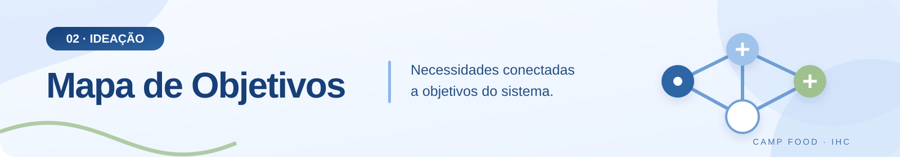

<a href="../README.md"> Início</a> &nbsp;›&nbsp; <b>Etapa 2 · Ideação</b> &nbsp;›&nbsp; Mapa de Objetivos

---

# 3. Mapas de Objetivos

A elaboração dos Mapas de Objetivos corresponde a uma etapa importante do processo de ideação do Camp Food, pois permite organizar e representar as principais metas que os diferentes perfis de usuários desejam alcançar ao utilizar a plataforma. A partir da metamensagem e das personas definidas anteriormente, foram identificadas necessidades específicas e compartilhadas, considerando o contexto de comercialização e aquisição de alimentos no ambiente universitário.

A construção desses mapas buscou transformar as necessidades identificadas em objetivos organizados hierarquicamente, partindo de uma finalidade principal e desdobrando-a em objetivos específicos que contribuem para sua realização. Essa organização facilita a compreensão das expectativas dos usuários e evidencia como suas diferentes necessidades se relacionam com a proposta do sistema.

Para contemplar as diferentes perspectivas de utilização, os mapas foram organizados em uma representação geral e em representações individuais para cada persona. O mapa geral reúne os objetivos dos perfis envolvidos e destaca os pontos de conexão entre eles, enquanto os mapas individuais aprofundam as particularidades de cada usuário. Também foram considerados objetivos compartilhados, especialmente aqueles necessários para o acesso e a utilização da plataforma.

## 3.1 Mapa Geral de Objetivos

O Mapa Geral de Objetivos apresenta uma visão abrangente das metas estabelecidas para os usuários do Camp Food. Sua finalidade é reunir, em uma única representação, os objetivos das personas Mariana Oliveira, Gabriel Santos e Camila Rodrigues, permitindo visualizar tanto as necessidades particulares de cada perfil quanto os pontos de convergência entre eles.

A organização geral evidencia a relação complementar entre vendedores e compradores dentro do ambiente proposto. De um lado, estão os objetivos relacionados à divulgação de produtos, à atualização de informações e à organização das solicitações de compra. De outro, encontram-se os objetivos associados à localização de vendedores, à consulta de produtos, à verificação de disponibilidade e à realização de compras. Além disso, a representação considera objetivos comuns de acesso à plataforma, necessários para que os diferentes perfis possam utilizar o sistema.

Essa visão integrada permite compreender que o Camp Food depende da participação de diferentes usuários para cumprir sua finalidade: aproximar vendedores e compradores do ambiente universitário, centralizando informações sobre produtos e facilitando a interação entre as partes. Assim, o mapa geral funciona como uma referência para compreender a estrutura de objetivos que orienta o desenvolvimento da solução.

  

  <b>Figura 1.</b> Mapa Geral de Objetivos do Camp Food.

## 3.2 Mapas Individuais de Objetivos

Após a apresentação da visão geral, foram elaborados mapas individuais para cada persona, com o propósito de detalhar os objetivos de acordo com suas necessidades e seu papel na utilização do Camp Food. Essa divisão permite analisar separadamente as expectativas de cada perfil, sem perder a relação entre os objetivos individuais e a proposta geral da plataforma.

Cada mapa apresenta uma estrutura própria, organizada a partir do objetivo principal da persona e de seus respectivos desdobramentos. Dessa maneira, torna-se possível identificar quais resultados cada usuário pretende alcançar e quais objetivos específicos estão associados à sua experiência de interação com o sistema.

### 3.2.1 Mariana Oliveira — Usuária Vendedora (UV)

Mariana Oliveira representa o perfil de usuária responsável pela comercialização de alimentos no ambiente universitário. Sua persona considera as dificuldades enfrentadas por vendedores que utilizam aplicativos de mensagens e redes sociais para divulgar seus produtos, responder aos interessados e informar alterações na disponibilidade dos alimentos. Esse contexto pode tornar o atendimento menos organizado, especialmente quando há diferentes compradores interessados e mudanças frequentes nas quantidades disponíveis.

Diante dessas necessidades, seu objetivo principal consiste em **ampliar suas vendas e otimizar o atendimento aos clientes**. O mapa de objetivos de Mariana organiza as metas relacionadas à divulgação dos produtos, à apresentação das informações no catálogo, à atualização da disponibilidade e à organização das solicitações de compra recebidas.

A representação demonstra como esses objetivos contribuem para uma experiência de venda mais estruturada. A possibilidade de centralizar as informações dos produtos e manter os compradores atualizados é importante para reduzir dificuldades de comunicação e evitar situações em que os interessados não tenham conhecimento sobre a disponibilidade dos alimentos. Portanto, os objetivos dessa persona estão diretamente relacionados à organização das atividades de venda e ao aprimoramento da interação com os compradores.

  

*Figura 2 — Mapa de Objetivos de Mariana Oliveira (Usuária Vendedora).*

### 3.2.2 Gabriel Santos — Usuário Comprador (UC)

Gabriel Santos representa o perfil de usuário interessado em encontrar e adquirir alimentos comercializados no ambiente universitário. Sua persona considera dificuldades como localizar vendedores, encontrar informações sobre os produtos e confirmar se determinado alimento ainda está disponível antes de se deslocar até o ponto de venda.

Seu objetivo principal é **encontrar alimentos disponíveis e realizar compras sem perder tempo**. A partir dessa finalidade, o mapa apresenta objetivos relacionados à localização de vendedores e pontos de venda, à identificação de produtos de interesse, à consulta de informações relevantes e à verificação da disponibilidade dos alimentos para a tomada de decisão.

A organização desses objetivos evidencia a importância de reunir informações que normalmente podem estar dispersas em diferentes canais de comunicação. Ao facilitar a busca por vendedores e a consulta dos produtos, o Camp Food busca tornar a jornada de compra mais prática e reduzir deslocamentos desnecessários, contribuindo para que o usuário tenha melhores condições de decidir sobre uma compra antes de entrar em contato com o vendedor.

  

*Figura 3 — Mapa de Objetivos de Gabriel Santos (Usuário Comprador).*

### 3.2.3 Camila Rodrigues — Usuária Compradora com Necessidades de Acessibilidade (UCA)

Camila Rodrigues representa o perfil de usuária compradora utilizado para orientar a consideração de requisitos de acessibilidade no Camp Food. Sua persona foi elaborada considerando possíveis barreiras encontradas durante a utilização de plataformas digitais, especialmente aquelas relacionadas à visualização de informações, à identificação de elementos da interface e à navegação autônoma.

Seu objetivo principal é **consultar produtos e realizar compras com autonomia e acessibilidade**. O mapa organiza objetivos relacionados ao acesso às informações disponibilizadas na plataforma e à utilização de recursos que favoreçam uma experiência mais acessível, como ajuste do tamanho da fonte, contraste adequado, identificação de elementos visuais, descrições de imagens e compatibilidade com leitores de tela.

A inclusão dessa perspectiva amplia a compreensão das necessidades que devem ser consideradas durante o desenvolvimento do sistema. Mais do que disponibilizar as mesmas funcionalidades aos diferentes usuários, é importante considerar as condições necessárias para que essas funcionalidades possam ser utilizadas de maneira compreensível e autônoma. Dessa forma, os objetivos de Camila reforçam a importância de incorporar a acessibilidade como parte da experiência de utilização do Camp Food.

Ressalta-se que essa persona possui caráter hipotético e foi desenvolvida como referência para orientar a análise de acessibilidade, não representando um perfil validado diretamente pelas entrevistas realizadas.

  

*Figura 4 — Mapa de Objetivos de Camila Rodrigues (Usuária Compradora com Necessidades de Acessibilidade).*

## 3.3 Considerações sobre os Mapas de Objetivos

A construção dos mapas permitiu organizar as necessidades dos diferentes perfis de usuários e compreender como elas se relacionam dentro da proposta do Camp Food. Embora cada persona apresente objetivos próprios, suas experiências estão conectadas pela utilização de uma mesma plataforma, na qual vendedores e compradores participam de etapas complementares da comercialização de alimentos.

Enquanto os objetivos de Mariana estão concentrados na divulgação e na organização das vendas, os de Gabriel estão relacionados à busca por produtos e à realização de compras. Já os objetivos de Camila acrescentam a perspectiva da acessibilidade, destacando a necessidade de proporcionar condições adequadas de nave

---

⬅️ <a href="2-metamensagem.md">Metamensagem</a> &nbsp;·&nbsp; <a href="../README.md"> Voltar ao início</a> &nbsp;·&nbsp; <a href="4-htas.md">HTAs</a> ➡️

