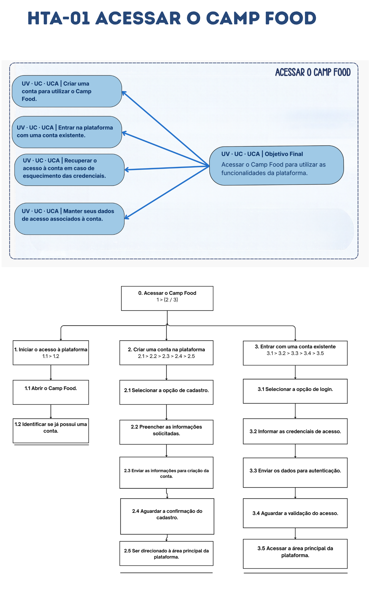
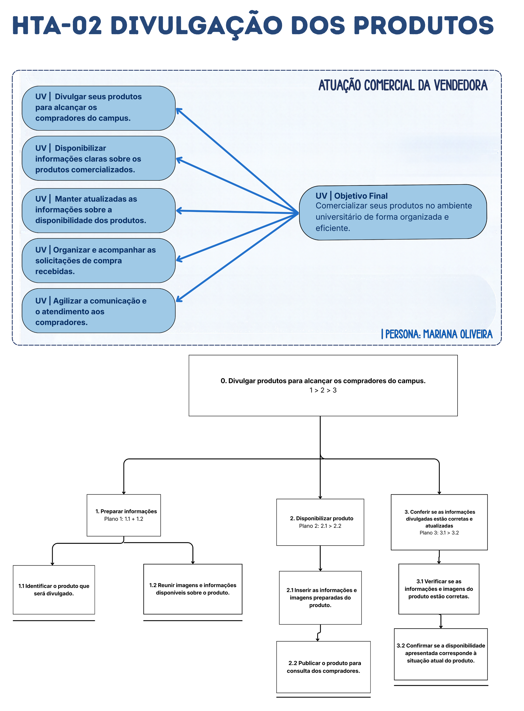
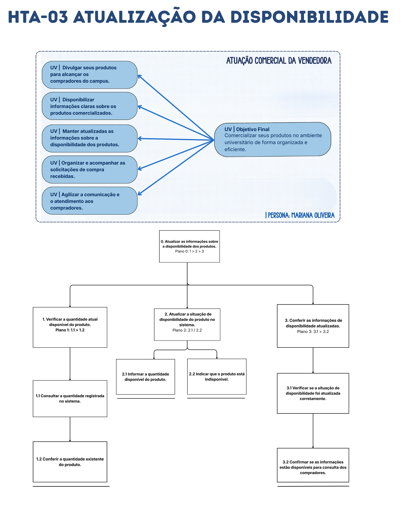
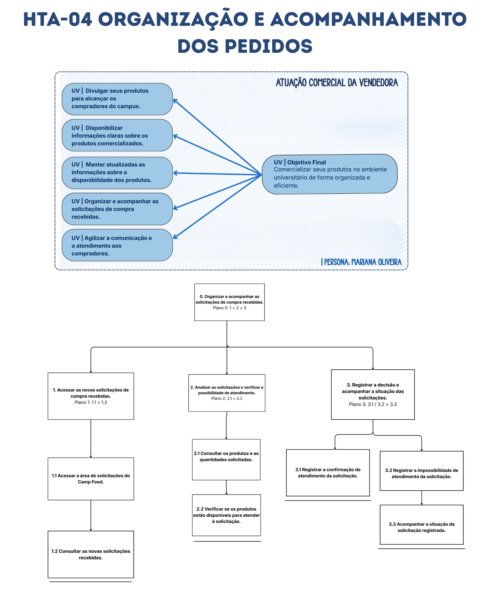
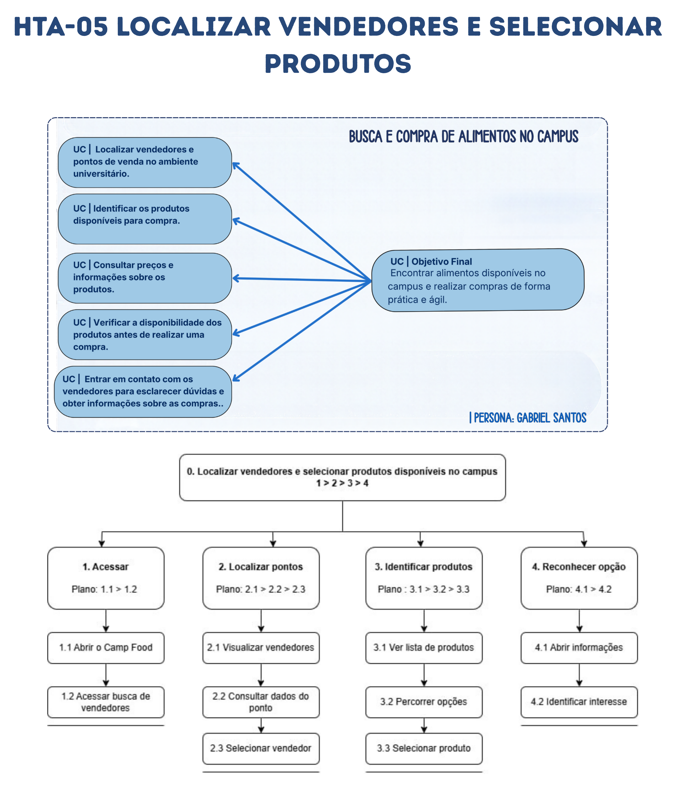
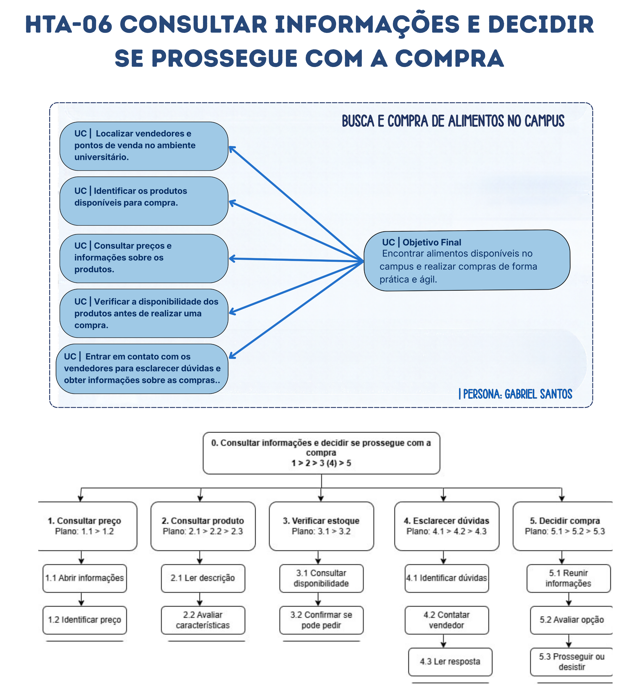
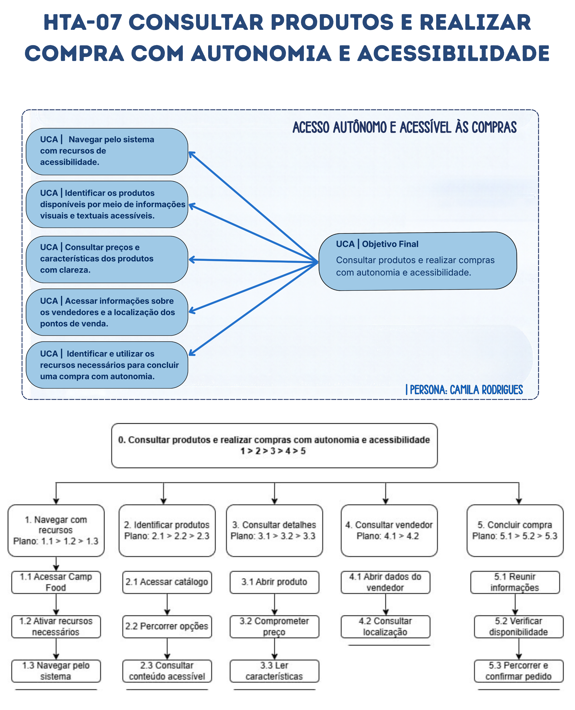

<a href="../README.md">🏠 Início</a> &nbsp;›&nbsp; <b>Etapa 2 · Ideação</b> &nbsp;›&nbsp; HTAs

---

# 4. Análise Hierárquica de Tarefas (HTAs) 

A Análise Hierárquica de Tarefas (HTA) foi utilizada para aprofundar os objetivos identificados nos Mapas de Objetivos, descrevendo as principais tarefas que os usuários precisam realizar para alcançar os resultados desejados ao utilizar o Camp Food.

Diferentemente dos mapas de objetivos, que apresentam as metas dos usuários de maneira geral, as HTAs permitem compreender como essas metas podem ser alcançadas por meio da decomposição de tarefas principais em subtarefas e operações. Essa estrutura também permite identificar sequências de execução, escolhas entre alternativas e condições que podem modificar o percurso de interação.

Para o Camp Food, foram elaboradas sete HTAs, contemplando o acesso compartilhado à plataforma e as principais atividades relacionadas aos perfis de vendedores e compradores. Cada análise está associada a um objetivo identificado nos mapas e considera as necessidades específicas das personas, mantendo a coerência com a proposta e a metamensagem do sistema.

## 4.1 HTA 01 — Acesso ao Camp Food

**Personas:** Mariana Oliveira (UV), Gabriel Santos (UC) e Camila Rodrigues (UCA).

**Objetivo principal:** Acessar o Camp Food.

### Propósito

Esta HTA representa o processo de acesso à plataforma, considerado um objetivo compartilhado entre os diferentes perfis de usuários. Antes de utilizar as funcionalidades do Camp Food, o usuário precisa acessar o ambiente do sistema, seja por meio de uma conta já existente ou realizando um novo cadastro.

A análise contempla as duas possibilidades de acesso, considerando que usuários novos precisam fornecer as informações solicitadas para criar uma conta, enquanto usuários cadastrados podem prosseguir diretamente pelo processo de login. Dessa forma, a HTA representa um fluxo inicial comum às personas, independentemente de suas atividades específicas dentro da plataforma.

### Descrição do fluxo

O processo começa com a abertura do Camp Food e a identificação da situação do usuário em relação à existência de uma conta. A partir dessa verificação, existem dois caminhos possíveis: realizar o cadastro ou efetuar o login.

No cadastro, o usuário seleciona a opção correspondente, preenche as informações solicitadas, envia os dados e aguarda a confirmação para acessar a área principal da plataforma. No login, seleciona a opção de entrada, informa suas credenciais e aguarda a validação dos dados para prosseguir.

Assim, embora existam dois caminhos distintos, ambos possuem a mesma finalidade: permitir que o usuário acesse o ambiente principal do Camp Food.

### Decisões e condições

A principal decisão está relacionada à existência de uma conta. Caso o usuário ainda não possua cadastro, deverá seguir pelo processo de criação de conta. Caso já esteja cadastrado, poderá realizar o login.

A validação das informações também representa uma condição importante para a continuidade do acesso. Situações como dados incorretos ou falha na confirmação precisam ser consideradas na definição final do comportamento do sistema.

### Contribuição para a interação

Essa HTA estabelece o fluxo inicial de utilização do Camp Food e demonstra como diferentes perfis podem acessar o mesmo ambiente. Sua importância está em organizar o primeiro contato do usuário com a plataforma, oferecendo caminhos distintos de entrada sem separar a experiência de utilização do sistema.

  

*Figura 5 — Análise Hierárquica de Tarefas (HTA 01): Acesso ao Camp Food.*

## 4.2 HTA 02 — Divulgação dos Produtos

**Persona:** Mariana Oliveira (UV).

**Objetivo de origem no mapa:** Divulgar seus produtos para alcançar os compradores do campus.

### Propósito

Esta HTA representa as atividades realizadas por Mariana para divulgar os alimentos comercializados no ambiente universitário. A análise considera a necessidade de preparar as informações dos produtos e disponibilizá-las no Camp Food, permitindo que os compradores conheçam as opções oferecidas.

A tarefa está relacionada às dificuldades enfrentadas por vendedores que dependem de diferentes canais de comunicação para apresentar seus produtos e informar os interessados. Nesse contexto, a plataforma busca oferecer um espaço centralizado para organizar e apresentar as informações necessárias à divulgação.

### Descrição do fluxo

O processo começa com a preparação das informações do produto que será divulgado. Essa etapa envolve identificar o alimento e reunir os elementos necessários para sua apresentação, como fotografias, descrição, preço e demais características disponíveis.

Após a preparação, o produto é disponibilizado no catálogo ou feed do Camp Food. Em seguida, a vendedora realiza uma conferência das informações apresentadas, verificando se o conteúdo está claro e atualizado para os compradores.

A identificação do produto e a reunião das informações podem ocorrer em qualquer ordem, pois ambas contribuem para a preparação do conteúdo antes de sua disponibilização.

### Decisões e condições

Caso ocorram alterações nas características ou nas informações do produto, será necessário revisar o conteúdo divulgado para manter sua consistência.

A ausência de uma fotografia também representa uma situação que precisa ser considerada. Entretanto, a possibilidade de publicar produtos sem imagem ainda deve ser definida pela equipe, não sendo tratada como uma funcionalidade confirmada.

### Contribuição para a interação

A HTA detalha o objetivo de divulgação em etapas que permitem compreender como a vendedora prepara, disponibiliza e revisa as informações dos produtos. Essa organização contribui para estruturar a interação com o catálogo da plataforma e facilitar o acesso dos compradores às opções anunciadas.

*Figura 6 — Análise Hierárquica de Tarefas (HTA 02): Divulgação dos Produtos.*

## 4.3 HTA 03 — Atualização da Disponibilidade dos Produtos

**Persona:** Mariana Oliveira (UV).

**Objetivo de origem no mapa:** Manter atualizadas as informações sobre a disponibilidade dos produtos.

### Propósito

Esta HTA descreve a tarefa de manter atualizadas as informações referentes à quantidade e à disponibilidade dos alimentos anunciados no Camp Food. A análise considera a importância de apresentar informações coerentes com a situação real dos produtos, evitando que compradores encontrem informações desatualizadas.

A atualização da disponibilidade é especialmente importante no contexto universitário, em que determinados alimentos podem ser vendidos rapidamente e as quantidades disponíveis podem sofrer alterações ao longo do dia.

### Descrição do fluxo

O processo começa com a verificação da quantidade atual de produtos disponíveis. Após conferir a situação real, Mariana atualiza as informações registradas na plataforma.

Nessa etapa, existem duas possibilidades: informar a quantidade disponível, quando ainda existem unidades para comercialização, ou indicar que o produto está indisponível, quando não há mais unidades.

Depois da atualização, a informação fica disponível para consulta dos compradores, permitindo que eles tenham acesso à situação mais recente do produto.

Esse processo pode ser repetido sempre que houver alterações na quantidade disponível, mantendo as informações do catálogo coerentes com a realidade da venda.

### Decisões e condições

A principal decisão está relacionada à quantidade existente. Quando ainda há unidades disponíveis, a vendedora informa a quantidade correspondente. Quando não há mais unidades, deve indicar a indisponibilidade do produto.

Outro aspecto importante envolve o funcionamento da atualização em situações de conexão limitada ou ausência de internet. Embora o projeto considere condições de uso offline ou parcialmente offline, a forma de sincronização das informações ainda precisa ser definida pela equipe.

### Contribuição para a interação

Essa HTA demonstra como a atividade da vendedora está diretamente relacionada às informações consultadas pelos compradores. Ao organizar a verificação e a atualização da disponibilidade, a análise contribui para reduzir incertezas durante a jornada de compra e fortalecer a comunicação entre os participantes da plataforma.

*Figura 7 — Análise Hierárquica de Tarefas (HTA 03): Atualização da Disponibilidade dos Produtos.*

## 4.4 HTA 04 — Organização e Acompanhamento dos Pedidos

**Persona:** Mariana Oliveira (UV).

**Objetivo de origem no mapa:** Organizar e acompanhar as solicitações de compra recebidas.

### Propósito

Esta HTA representa as atividades realizadas pela vendedora para consultar, analisar e acompanhar as solicitações de compra recebidas por meio do Camp Food.

A tarefa considera a necessidade de organizar as solicitações dos compradores e verificar se os produtos solicitados podem ser disponibilizados. Essa organização busca facilitar o acompanhamento dos pedidos e auxiliar a vendedora na identificação das solicitações que podem ou não ser atendidas.

### Descrição do fluxo

O processo começa com o acesso à relação de novas solicitações recebidas. Em seguida, Mariana consulta os dados de cada solicitação e verifica quais produtos e quantidades foram pedidos.

Após analisar essas informações, a vendedora verifica se possui disponibilidade suficiente para atender à solicitação. A partir dessa avaliação, existem duas possibilidades: confirmar que consegue atender ao pedido ou informar que não consegue atendê-lo devido à indisponibilidade dos produtos.

Por fim, a situação da solicitação é acompanhada até o encaminhamento definido pelo projeto, permitindo que a vendedora mantenha o controle das solicitações recebidas.

### Decisões e condições

A principal decisão está relacionada à possibilidade de atender à solicitação. Quando os produtos e as quantidades estão disponíveis, a vendedora pode confirmar o atendimento. Caso contrário, deverá informar a impossibilidade de atender ou a indisponibilidade identificada.

O encaminhamento posterior da solicitação também precisa ser definido pela equipe. Questões como retirada, confirmação final ou cancelamento não devem ser consideradas funcionalidades estabelecidas enquanto suas regras não estiverem especificadas.

### Contribuição para a interação

Essa HTA detalha como a vendedora transforma as solicitações recebidas em decisões de atendimento e acompanhamento. Sua contribuição está na organização do fluxo de pedidos, facilitando a compreensão das atividades necessárias para gerenciar as solicitações e manter a comunicação entre vendedores e compradores.

*Figura 8 — Análise Hierárquica de Tarefas (HTA 04): Organização e Acompanhamento dos Pedidos.*

## 4.5 HTA 05 — Localização de Vendedores e Seleção de Produtos

**Persona:** Gabriel Santos (UC).

**Objetivo de origem no mapa:** Localizar vendedores e pontos de venda e identificar produtos de interesse.

### Propósito

Esta HTA representa a etapa inicial da jornada de compra de Gabriel no Camp Food, considerando a busca por vendedores, a identificação de pontos de venda no ambiente universitário e a seleção de produtos que correspondam aos seus interesses.

A análise considera uma das principais dificuldades identificadas para o perfil comprador: encontrar vendedores e informações sobre os alimentos disponíveis sem depender de diferentes canais de comunicação.

### Descrição do fluxo

O processo começa com o acesso à área de descoberta de vendedores e produtos. Em seguida, Gabriel procura os vendedores e pontos de venda disponíveis no ambiente universitário, podendo explorar a relação apresentada pela plataforma e consultar as informações de localização fornecidas.

Após identificar os vendedores, o usuário percorre as opções de produtos e seleciona aqueles que despertam seu interesse para uma consulta mais detalhada.

Essa etapa concentra-se na descoberta e na seleção dos produtos. A análise de preços, características e disponibilidade para a tomada de decisão é aprofundada na HTA seguinte.

### Decisões e condições

Durante a busca, o usuário pode encontrar ou não opções que correspondam ao que procura. Caso não identifique produtos ou vendedores relevantes, poderá retornar à exploração e consultar outras opções disponíveis.

A análise considera as informações de localização apresentadas pela plataforma, sem pressupor o uso de GPS, geolocalização automática ou filtros específicos que ainda não tenham sido definidos no projeto.

### Contribuição para a interação

Essa HTA organiza o início da jornada de compra, permitindo compreender como o usuário descobre vendedores e identifica produtos de interesse. Sua contribuição está em estruturar a navegação entre as opções disponíveis e preparar a continuidade da consulta, que será aprofundada na análise seguinte.

*Figura 9 — Análise Hierárquica de Tarefas (HTA 05): Localização de Vendedores e Seleção de Produtos.*

## 4.6 HTA 06 — Consulta de Informações e Decisão de Compra

**Persona:** Gabriel Santos (UC).

**Objetivo de origem no mapa:** Consultar informações dos produtos, verificar sua disponibilidade e decidir como prosseguir com a compra.

### Propósito

Esta HTA representa a continuidade da jornada de compra de Gabriel, aprofundando a etapa de avaliação dos produtos selecionados. Depois de localizar vendedores e identificar opções de interesse, o comprador precisa consultar informações que auxiliem sua decisão, como preços, descrições, ingredientes e características dos alimentos.

A análise também considera a necessidade de verificar a disponibilidade dos produtos antes de decidir como prosseguir, evitando que o usuário dependa exclusivamente de informações obtidas por outros canais ou precise se deslocar sem saber se o alimento ainda está disponível.

### Descrição do fluxo

O processo começa com a consulta dos preços e das informações dos produtos selecionados. Essas informações permitem que Gabriel avalie as características dos alimentos e verifique se correspondem ao que procura.

Em seguida, o usuário verifica a disponibilidade do produto e consulta a localização do ponto de venda. Com base nas informações obtidas, poderá decidir entre prosseguir com a compra ou buscar esclarecimentos diretamente com o vendedor, caso ainda existam dúvidas.

A possibilidade de entrar em contato com o vendedor funciona como uma alternativa para situações em que as informações disponíveis não sejam suficientes para a tomada de decisão.

### Decisões e condições

A principal decisão está relacionada à suficiência das informações e à disponibilidade do produto. Quando as informações são suficientes e o produto está disponível, o usuário pode prosseguir com a compra conforme o fluxo definido para o Camp Food.

Caso existam dúvidas ou informações que precisem ser esclarecidas, o comprador poderá buscar contato com o vendedor antes de prosseguir.

O processo de finalização da compra deve respeitar as funcionalidades efetivamente definidas pelo projeto, sem pressupor mecanismos de pagamento, entrega, reserva ou carrinho integrado que ainda não tenham sido estabelecidos.

### Contribuição para a interação

Essa HTA aprofunda a etapa de avaliação e decisão da jornada de compra, demonstrando como as informações disponibilizadas pelo Camp Food auxiliam o usuário a escolher como prosseguir. Sua contribuição está em organizar a consulta dos dados dos produtos, a verificação de disponibilidade e a possibilidade de esclarecimento de dúvidas, favorecendo uma experiência de compra mais informada.

*Figura 10 — Análise Hierárquica de Tarefas (HTA 06): Consulta de Informações e Decisão de Compra.*

## 4.7 HTA 07 — Consulta e Compra com Acessibilidade

**Persona:** Camila Rodrigues (UCA).

**Objetivo de origem no mapa:** Consultar produtos e realizar compras com autonomia e acessibilidade.

### Propósito

Esta HTA representa a jornada de utilização do Camp Food considerando as necessidades de acessibilidade da persona Camila. A análise busca compreender como a usuária pode acessar a plataforma, localizar vendedores, consultar informações dos produtos e prosseguir com uma compra utilizando recursos que favoreçam sua autonomia.

A acessibilidade é considerada ao longo de toda a interação, e não apenas em uma etapa isolada. Por isso, a análise contempla recursos como ajuste do tamanho da fonte, contraste adequado e compatibilidade com leitores de tela, de modo que as informações disponibilizadas possam ser compreendidas durante a navegação.

### Descrição do fluxo

O processo começa com o acesso e a navegação na plataforma utilizando os recursos de acessibilidade necessários. A usuária pode ajustar o tamanho da fonte e utilizar recursos de contraste e leitor de tela compatível, conforme suas necessidades.

Em seguida, Camila localiza produtos e vendedores por meio das informações apresentadas de forma acessível. Após encontrar opções de interesse, consulta os preços e as características dos produtos para compreender as informações disponíveis.

Na sequência, verifica a disponibilidade dos alimentos e a localização do ponto de venda. Com essas informações, poderá prosseguir com a compra de forma autônoma, respeitando o fluxo de utilização definido pelo sistema.

### Decisões e condições

Os recursos de acessibilidade devem acompanhar as diferentes etapas da navegação. Ajustes de fonte e contraste não precisam ser realizados novamente em todas as visitas caso as preferências do usuário permaneçam ativas.

Uma condição importante está relacionada à disponibilização das informações em formatos acessíveis. Caso algum conteúdo visual não possua uma alternativa textual ou não seja compatível com leitores de tela, essa situação deve ser identificada como uma limitação de acessibilidade e considerada na avaliação da interface.

### Contribuição para a interação

Essa HTA amplia a análise da jornada de compra ao considerar que diferentes usuários podem necessitar de recursos específicos para interagir com a plataforma. Sua contribuição está em orientar a avaliação da acessibilidade durante todo o processo de descoberta e compra, verificando se as etapas podem ser realizadas com autonomia, sem depender da ajuda de terceiros.

*Figura 11 — Análise Hierárquica de Tarefas (HTA 07): Consulta e Compra com Acessibilidade.*

## 4.8 Considerações sobre as HTAs

As sete Análises Hierárquicas de Tarefas permitem aprofundar os objetivos identificados nos mapas, apresentando as principais atividades necessárias para que cada perfil alcance seus resultados ao utilizar o Camp Food.

Em conjunto, as análises contemplam o acesso compartilhado à plataforma, as atividades de divulgação e gerenciamento de produtos realizadas pela vendedora, a jornada de descoberta e compra do usuário comprador e as necessidades de acessibilidade consideradas para uma experiência mais inclusiva.

A decomposição das tarefas também possibilitou identificar decisões, alternativas e condições que influenciam o percurso de interação. Além disso, os pontos que ainda dependem de definição pela equipe foram destacados, evitando apresentar como funcionalidades confirmadas aspectos que permanecem em aberto.

Dessa maneira, as HTAs estabelecem uma ligação entre os objetivos identificados na etapa de ideação e a análise das interações necessárias para alcançá-los, contribuindo para a continuidade do desenvolvimento e da modelagem do Camp Food.

---

⬅️ [Mapa de Objetivos](3-mapa-de-objetivos.md) &nbsp;·&nbsp; [🏠 Voltar ao início](../README.md) &nbsp;·&nbsp; [Diagramas MoLIC](5-molic.md) ➡️

