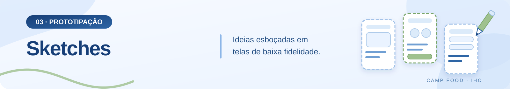

<a href="../README.md"> Início</a> &nbsp;›&nbsp; <b>Etapa 3 · Prototipação</b> &nbsp;›&nbsp; Sketches

---

# 1. Sketches — Protótipos de Baixa Fidelidade

## 1.1 Introdução

Os sketches do Camp Food foram desenvolvidos com o objetivo de representar visualmente as primeiras ideias da interface do aplicativo, permitindo analisar a organização das informações, a disposição dos elementos e os caminhos de navegação antes da construção do protótipo de alta fidelidade. Os esboços foram elaborados em baixa fidelidade, priorizando a estrutura das telas e as funcionalidades principais, sem preocupação inicial com detalhes visuais, cores ou elementos decorativos.

---
## 1.2 Método de elaboração

O desenvolvimento foi realizado por meio da criação de esboços das principais funcionalidades do sistema, considerando as necessidades dos dois perfis de usuários: vendedor e comprador. Para algumas funcionalidades, foram elaboradas alternativas de organização (A e B), permitindo comparar diferentes possibilidades de navegação, disposição dos componentes e apresentação das informações.

---

## 2. Sketches — Perfil Vendedor

### 2.1 Acesso e criação de conta

Foram elaboradas duas alternativas para a tela de acesso:

- **Alternativa A:** apresenta as opções de entrar e criar conta em abas, permitindo alternar entre os formulários na mesma interface.

    
    
    
<b>Figura 1.</b> Sketches - Acesso-A: Entrar e criar contas em abas.

    

- **Alternativa B:** organiza o acesso e o cadastro em caminhos separados, oferecendo uma escolha inicial ao usuário.

<b>Figura 2.</b> Sketches - acessar-B: Caminhos separados .

As propostas buscam facilitar a identificação das opções de acesso e tornar o processo de autenticação mais simples.

---

### 2.2 Gerenciamento de produtos

Foram desenvolvidas duas propostas para o gerenciamento dos produtos:

- **Alternativa A:** apresenta a lista de produtos e os formulários de cadastro e edição em telas separadas.
  
  
    
<b>Figura 3.</b> Sketches - Produtos-A: Lista e formulários em telas separadas.

  
- **Alternativa B:** utiliza abas, grade de produtos e painel de edição, concentrando diferentes funcionalidades em uma mesma área.

  
 
<b>Figura 3.</b> Sketches - Produtos-B: Abas, grade e painel de edição

 
As alternativas permitem analisar diferentes formas de cadastrar produtos, editar informações e atualizar a disponibilidade do estoque.

---

### 2.3 Gerenciamento de pedidos

A tela de pedidos foi planejada para permitir que o vendedor acompanhe as solicitações recebidas pelos compradores.

O esboço apresenta informações como:
- Nome do comprador;
- Produtos solicitados;
- Quantidades dos itens;
- Situação do pedido;
- Opções para confirmar o atendimento ou informar a impossibilidade de atendê-lo.
---
 - **Alternativa A:**
  image
  
 - **Alternativa B:**
  image
  
---

## 3. Sketches — Perfil Comprador

### 3.1 Explorar vendedores e produtos

Foram elaboradas duas alternativas para a navegação e descoberta de produtos:

- **Alternativa A:** organiza a exploração em duas etapas, primeiro apresentando a lista de vendedores e depois os produtos disponíveis de cada vendedor.

  image
  
- **Alternativa B:** apresenta uma lista única expansível, permitindo visualizar vendedores e acessar seus produtos dentro da mesma estrutura.

  image

As propostas buscam facilitar a localização de vendedores e produtos disponíveis no ambiente universitário.

---

### 3.2 Detalhes do produto

Foram elaboradas duas alternativas para a apresentação das informações de um produto:

- **Alternativa A:** reúne as informações e as ações em uma única página, incluindo preço, disponibilidade, descrição, vendedor e realização do pedido.

  image
  
- **Alternativa B:** utiliza um resumo fixo e abas para separar as informações do produto e do vendedor, buscando organizar melhor o conteúdo.

image

As interfaces também apresentam recursos para selecionar a quantidade desejada e realizar pedidos.

---

## 4. Considerações de Acessibilidade

Durante a elaboração dos sketches, foram consideradas alternativas para tornar a interface mais acessível e facilitar sua utilização por diferentes usuários.

Entre os recursos representados, destacam-se:

- **Ajuste do tamanho da letra:** permite aumentar ou diminuir o tamanho dos textos.
- **Alto contraste:** oferece uma alternativa visual para melhorar a diferenciação entre os elementos da interface.
- **Compatibilidade com leitores de tela:** considera a utilização de tecnologias assistivas.
- **Descrição textual das imagens:** prevê textos alternativos para auxiliar na compreensão das imagens dos produtos.
- **Organização dos elementos:** busca manter formulários, botões e informações distribuídos de maneira compreensível.

Essas considerações foram incorporadas desde os primeiros esboços para que a acessibilidade seja considerada durante o desenvolvimento da interface.

---

## 5. Relação dos Sketches com as HTAs

Os sketches foram elaborados considerando as HTAs (Hierarchical Task Analysis) desenvolvidas anteriormente, utilizando as tarefas identificadas para orientar a organização das interfaces e os caminhos de interação.

---

⬅️ <a href="../02-ideacao/5-molic.md">Diagramas MoLIC</a> &nbsp;·&nbsp; <a href="../README.md"> Voltar ao início</a>

