<p align="center">
  
</p>

<h1 align="center">Design de IHC — TP2</h1>

<p align="center">
  <b>Design de um aplicativo a partir de uma demanda real</b><br>
  Interação Humano-Computador · Universidade Federal do Amazonas (UFAM)
</p>

<p align="center">
  <a href="#-sobre-o-projeto">Sobre</a> ·
  <a href="#-etapas-do-projeto">Etapas</a> ·
  <a href="#-métodos-utilizados">Métodos</a> ·
  <a href="#-equipe">Equipe</a> ·
  <a href="#-organização-do-repositório">Estrutura</a>
</p>

---

## 🍬 Sobre o projeto

Este repositório reúne a documentação do Trabalho Prático 2 (TP2) da disciplina de Interação Humano-Computador. O objetivo é desenvolver o design de um aplicativo a partir de uma demanda real, investigando o problema, as necessidades dos usuários e as possibilidades de solução.

O projeto é desenvolvido por meio das etapas de **imersão**, **ideação** e **prototipação**, utilizando métodos e técnicas de Design de Interação para transformar as informações coletadas em propostas de interface coerentes com os objetivos e as necessidades dos usuários.

| | |
|---|---|
| 📱 **Aplicativo** | Camp Food |
| 🎓 **Disciplina** | Interação Humano-Computador (IHC) |
| 👨‍🏫 **Professor** | Dr. Andrey Rodrigues |
| 🏫 **Instituição** | Universidade Federal do Amazonas (UFAM) |
| 📅 **Entrega** | 23 de novembro de 2026, até às 23h50 |

---

## 📍 Etapas do projeto

<p align="center">
  
</p>

<p align="center">
  
</p>

### 🔍 Etapa 1

Etapa destinada à compreensão do problema, do contexto e das necessidades dos usuários.

<details>
<summary><b>🔍 Imersão · clique para ver os documentos</b></summary>

<br>

| Documento |
|---|
| [Briefing com o cliente](01-imersao/1-briefing.md) |
| [Matriz CSD — Certezas, Suposições e Dúvidas](01-imersao/2-matriz-csd.md) |
| [Pesquisa complementar com usuários](01-imersao/3-pesquisa-com-usuario.md) |

</details>

### 💡 Etapa 2

Etapa destinada à organização das informações obtidas e à definição dos objetivos e das interações dos usuários.

<details>
<summary><b>💡 Ideação · clique para ver os documentos</b></summary>

<br>

| Documento |
|---|
| [Personas — Técnica PATHY](02-ideacao/1-personas.md) |
| [Metamensagem](02-ideacao/2-metamensagem.md) |
| [Mapa de Objetivos](02-ideacao/3-mapa-de-objetivos.md) |
| [HTAs — Análise Hierárquica de Tarefas](02-ideacao/4-htas.md) |
| [Diagramas MoLIC](02-ideacao/5-molic.md) |

</details>

### ✏️ Etapa 3

Etapa destinada à elaboração de esboços de baixa fidelidade das telas do aplicativo, considerando as tarefas e os modelos de interação definidos anteriormente.

<details>
<summary><b>✏️ Prototipação · clique para ver os documentos</b></summary>

<br>

| Documento |
|---|
| [Sketches — Protótipos de Baixa Fidelidade](03-prototipacao/1-sketches.md) |

</details>

---

## 🧪 Métodos utilizados

Ao longo do projeto são utilizados métodos de investigação e modelagem de interação definidos no enunciado do TP2:

<details>
<summary><b>Ver lista de métodos</b></summary>

<br>

- Briefing com o cliente;
- Matriz CSD;
- Pesquisa complementar com usuários;
- Construção de personas utilizando a técnica PATHY;
- Engenharia Semiótica e construção da metamensagem;
- Mapa de objetivos dos usuários;
- Análise Hierárquica de Tarefas (HTA);
- Modelagem da interação por meio de diagramas MoLIC;
- Elaboração de sketches de baixa fidelidade.

Os resultados e as evidências de cada etapa são documentados nos arquivos correspondentes deste repositório.

</details>

## 🧰 Tecnologias e ferramentas

As ferramentas são registradas conforme forem utilizadas pela equipe durante o desenvolvimento do trabalho.

- **GitHub** — organização e documentação do projeto;
- **Markdown** — elaboração dos documentos;
- **Ferramentas de diagramas e prototipação** — a definir conforme as necessidades do projeto.

---

## 👥 Equipe

<table>
  <tr>
    <td align="center" width="33%"><b>Ana Vitória Farias Barroso</b></td>
    <td align="center" width="33%"><b>Jucilla Kétura Souza Sousa</b></td>
    <td align="center" width="33%"><b>Letícia Abreu de Araújo Marques</b></td>
  </tr>
  <tr>
    <td align="center" width="33%"><b>Luís Gustavo da Silva Gomes</b></td>
    <td align="center" width="33%"><b>Paolla Gabriele dos Santos Costa</b></td>
    <td align="center" width="33%"><b>Willian Gonçalves Monteiro</b></td>
  </tr>
</table>

---

## 🤖 Declaração de uso de Inteligência Artificial

blah blah blah

---

## 📂 Organização do repositório

```text
Design-IHC/
├── README.md
├── assets/                  # banner e identidade visual
├── 01-imersao/
│   ├── 1-briefing.md
│   ├── 2-matriz-csd.md
│   └── 3-pesquisa-com-usuario.md
├── 02-ideacao/
│   ├── 1-personas.md
│   ├── 2-metamensagem.md
│   ├── 3-mapa-de-objetivos.md
│   ├── 4-htas.md
│   ├── 5-molic.md
│   └── *.png                # mapas de objetivos e HTAs
└── 03-prototipacao/
    └── 1-sketches.md
```

---

<p align="center">
  Este repositório é atualizado ao longo do desenvolvimento do trabalho, registrando as etapas,<br>
  os resultados e as decisões de design tomadas pela equipe.<br><br>
  <sub>UFAM · 2026</sub>
</p>
